<p align="center">
  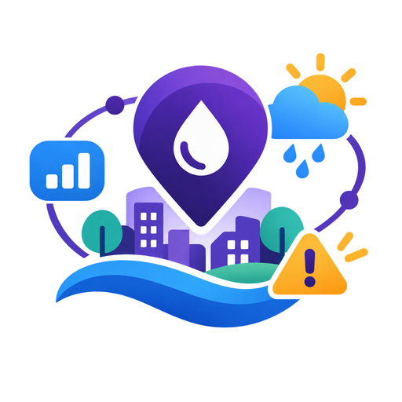<br>
  
</p>

<p align="center"><b>Nexo — conexão entre dados, território e pessoas.</b></p>

<p align="center">
  Painel mobile em Flutter que ajuda gestores públicos e cidadãos a antecipar problemas de água, clima e serviços em um bairro, com alertas que sempre explicam a evidência, a confiança e as limitações, e que deixam a decisão final com uma pessoa.
</p>

> **Global Solution 2026.2 · Cross-Platform Application Development · Desafio: Territory Predictive Insights (tema CitizenTech)**

---

## 1. Problema e público

**Problema.** Em muitos bairros, vazamentos, desperdício de água, ondas de calor e chuvas fortes só são percebidos quando o dano já aconteceu: a água se perde por dias, a rua alaga, a equipe chega tarde. Os dados existem, mas ficam espalhados e sem leitura simples para quem decide.

**O que o Nexo antecipa.**

- Alta anormal no consumo de água por setor do bairro (indício de vazamento ou desperdício).
- Calor intenso previsto, que pode pressionar a demanda por água.
- Chuva forte prevista, com risco de alagamentos.
- Concentração de ocorrências abertas em um mesmo setor.

**Para quem foi criado.**

- **Gestor público:** acompanha painéis, recebe alertas com justificativa e registra a decisão (aceitar, encaminhar ou descartar).
- **Cidadão:** registra ocorrências de forma anônima e acompanha a situação do território.

**Impacto social esperado.** Menos água desperdiçada, resposta mais rápida às ocorrências e decisões mais transparentes. O app exibe dois indicadores de benefício social: **litros em risco de desperdício** (estimativa semanal) e **tempo médio de resposta** às ocorrências.

---

## 2. Integrantes

| [Eduardo Bacelar Rudner] | [RM 564925] |

| [Giovana Dias Valentini] | [RM 562390] |

| [Raquel Amaral de Oliveira] | [RM 566491] |


---

## 3. Demonstração visual

<table>
  <tr>
    <td align="center"><br><sub><b>Splash</b><br>Identidade visual do Nexo</sub></td>
    <td align="center">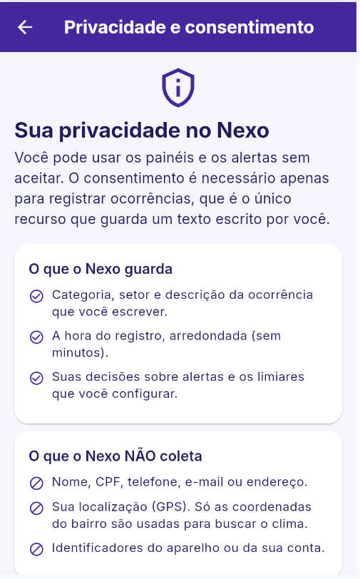<br><sub><b>Consentimento</b><br>O que é guardado e o que não é coletado</sub></td>
    <td align="center">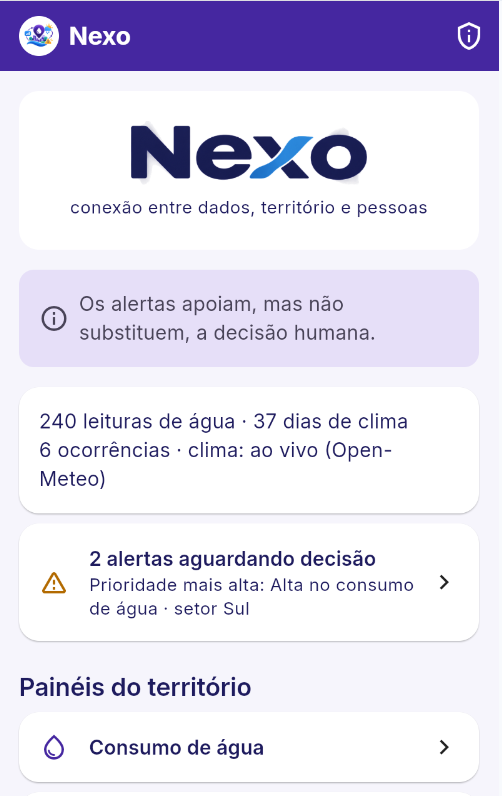<br><sub><b>Home</b><br>Painéis, alertas pendentes e aviso de decisão humana</sub></td>
  </tr>
  <tr>
    <td align="center">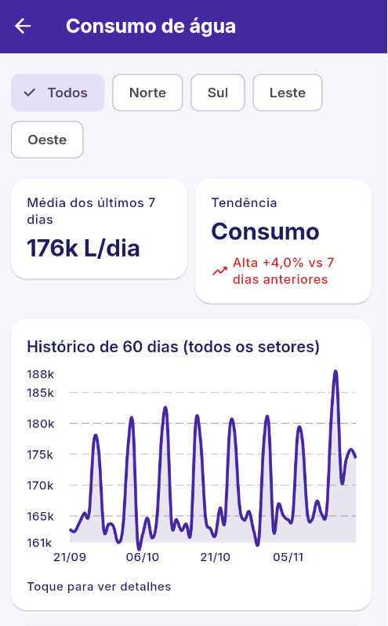<br><sub><b>Dashboard de água</b><br>Histórico, tendência e filtro por setor</sub></td>
    <td align="center">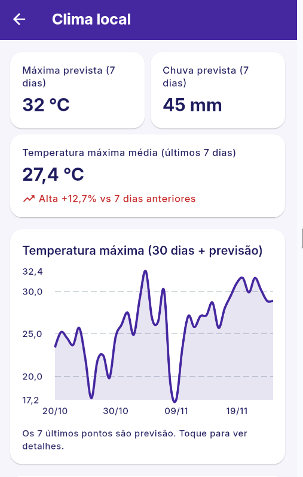<br><sub><b>Dashboard de clima</b><br>Temperatura e chuva (API Open-Meteo)</sub></td>
    <td align="center">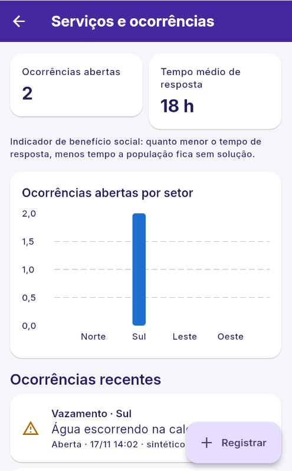<br><sub><b>Dashboard de serviços</b><br>Ocorrências e tempo médio de resposta</sub></td>
  </tr>
  <tr>
    <td align="center">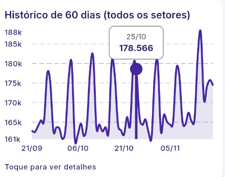<br><sub><b>Detalhe do indicador</b><br>Mínimo, máximo, média, tendência e fonte</sub></td>
    <td align="center">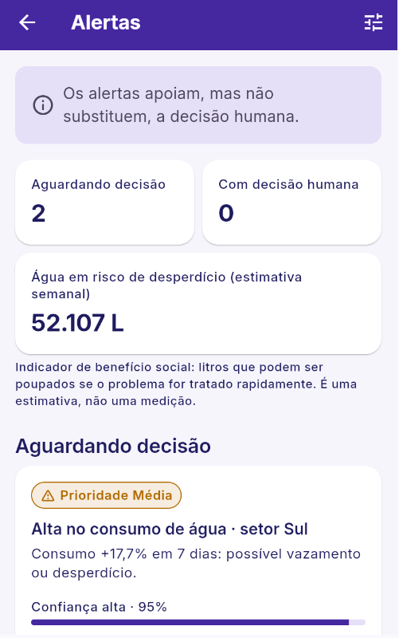<br><sub><b>Lista de alertas</b><br>Prioridade, confiança e litros em risco</sub></td>
    <td align="center">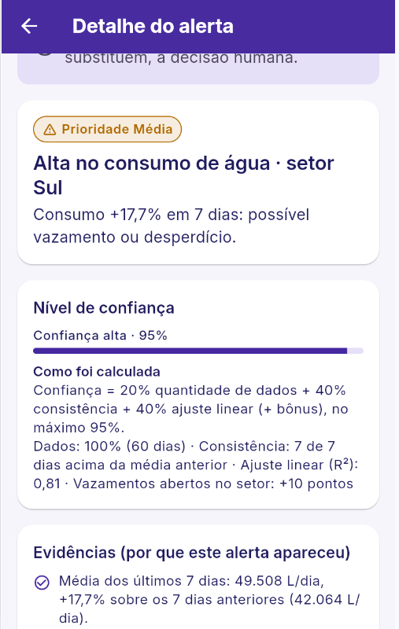<br><sub><b>Detalhe do alerta</b><br>Evidências, limitações e decisão humana</sub></td>
  </tr>
  <tr>
    <td align="center">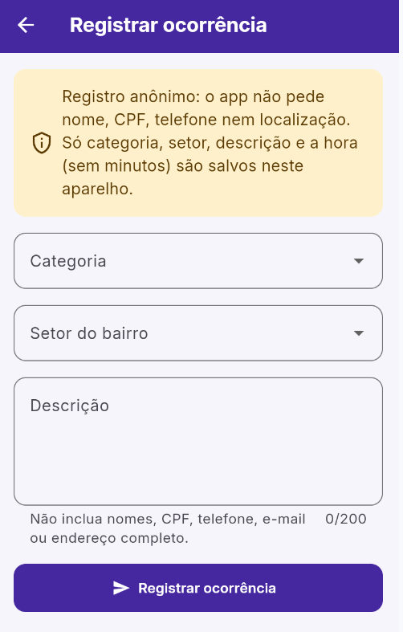<br><sub><b>Registrar ocorrência</b><br>Formulário com validação</sub></td>
    <td align="center">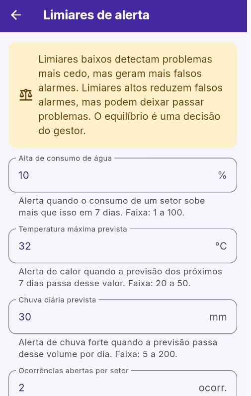<br><sub><b>Limiares de alerta</b><br>Formulário numérico com faixas válidas</sub></td>
    <td align="center">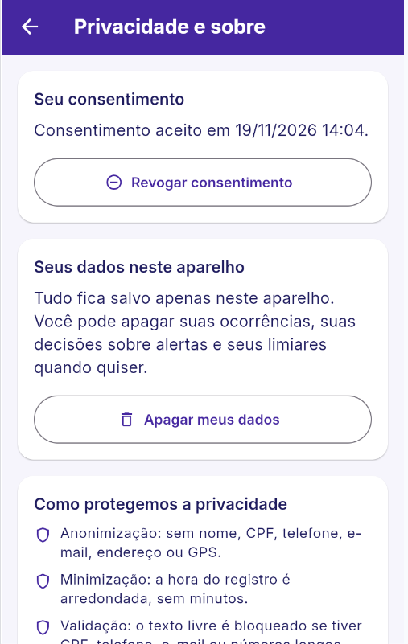<br><sub><b>Privacidade e sobre</b><br>Revogar consentimento e apagar dados</sub></td>
  </tr>
</table>

---

## 4. Funcionalidades

**Navegação e telas**

- [x] 12 telas com rotas nomeadas e passagem de parâmetros
- [x] Fluxo coerente: Home → dashboard → detalhe do indicador → alertas → detalhe do alerta

**Dashboards territoriais**

- [x] Dashboard de consumo de água (filtro por setor, histórico de 60 dias, tendência e comparação entre setores)
- [x] Dashboard de clima (30 dias de histórico, previsão de 7 dias, chuva prevista)
- [x] Dashboard de serviços e ocorrências (abertas por setor, tempo médio de resposta)
- [x] Gráficos de linha e de barras, cards com tendência e tooltips legíveis

**Alertas preditivos e transparência**

- [x] Quatro regras de alerta com limiares configuráveis
- [x] Justificativa (evidências), nível de confiança com explicação do cálculo e limitações em cada alerta
- [x] Aviso visível de que os alertas apoiam, mas não substituem, a decisão humana
- [x] Decisão humana registrada (aceitar, encaminhar ou descartar), com confirmação, observação opcional e opção de reabrir
- [x] Indicadores de benefício social (litros em risco e tempo médio de resposta)

**Estado, dados e persistência**

- [x] Estado global (Provider) compartilhado entre várias telas e estado local nas telas
- [x] Tratamento de carregamento, erro (com “tentar novamente”) e lista vazia
- [x] Consumo de API real (Open-Meteo) e de dados sintéticos
- [x] Persistência local: ocorrências (SQLite), limiares, decisões e consentimento (shared_preferences)
- [x] Uso offline: clima em cache e dados locais

**Formulários**

- [x] Registro de ocorrência com validação (inclui bloqueio de dados pessoais)
- [x] Configuração de limiares com validação de faixa

**Identidade, acessibilidade e privacidade**

- [x] Tema próprio (paleta do logo, tipografia Inter) e componentes reutilizáveis
- [x] Rótulos para leitores de tela, texto que respeita a fonte do sistema e contraste adequado
- [x] Consentimento explícito, anonimização, revogação e exclusão de dados

**Diferenciais**

- [x] Dados reais (API Open-Meteo)
- [x] Modo escuro
- [x] Animação com propósito (entrada suave da splash)
- [x] Testes automatizados (lógica de alertas e validações)
- [ ] APK de release no GitHub
- [ ] Mapa e geolocalização
- [ ] Notificações locais
- [ ] Explicação de alertas por IA generativa

---

## 5. Dados e alertas

### Fonte dos dados

| Dado | Origem | Tipo |
|---|---|---|
| Consumo de água por setor (Norte, Sul, Leste, Oeste, 60 dias) | `SyntheticDataService`, que simula uma API da companhia de água | **Sintético** |
| Ocorrências de exemplo | Geradas na primeira abertura do app | **Sintético** |
| Ocorrências registradas no app | Cidadão, de forma anônima | Autorizado (com consentimento) |
| Clima (temperatura máxima e chuva; 30 dias de histórico e 7 de previsão) | [Open-Meteo](https://open-meteo.com), API pública e gratuita, sem chave | **Real** |

O consumo de água tem **um vazamento simulado no setor Sul** (alta gradual nos últimos 12 dias), usado para demonstrar a detecção. O território é fictício (“Bairro Exemplo”) e suas coordenadas ficam em `lib/core/territory.dart`.

### Como os alertas são gerados

O motor (`lib/services/alert_engine.dart`) é Dart puro, sem dependência de Flutter, e por isso é testável. Ele nunca executa ações: só produz indícios.

| Regra | Dispara quando (limiar padrão, configurável) | Prioridade alta quando |
|---|---|---|
| Tendência de consumo, por setor | A média dos últimos 7 dias supera a dos 7 dias anteriores em mais de **10%** (exige ao menos 21 dias de dados) | A alta é pelo menos o dobro do limiar |
| Calor intenso | A previsão dos próximos 7 dias chega a **32 °C** ou mais | A máxima passa do limiar em 4 °C ou mais |
| Chuva forte | A previsão chega a **30 mm/dia** ou mais | O volume é pelo menos o dobro do limiar |
| Concentração de ocorrências, por setor | **2 ou mais** ocorrências abertas no setor | Há mais ocorrências abertas que o limiar |

### Métricas e nível de confiança

A confiança é um **índice heurístico entre 0 e 100%, e não uma probabilidade calibrada**. Cada alerta mostra como o número foi calculado.

- **Consumo de água:** 20% quantidade de dados (dias disponíveis ÷ 30) + 40% consistência (dias acima da média anterior ÷ 7) + 40% ajuste linear (R² da regressão dos últimos 14 dias) + bônus de até 10 pontos por vazamentos abertos no setor. Limitada a 95%.
- **Calor:** qualidade da previsão pela antecedência (90% menos 7 pontos por dia) com desconto de 15%, porque a ligação entre calor e consumo é uma suposição da regra.
- **Chuva:** 80% menos 9 pontos por dia de antecedência (mínimo 20%).
- **Ocorrências:** (25% + 15% por ocorrência aberta) ajustada pela participação da categoria dominante. Limitada a 80%.

Outras métricas exibidas: variação percentual de 7 dias, média, mínimo, máximo, excesso estimado de consumo (litros) e tempo médio de resposta.

### Limitações, vieses e quando as previsões não são confiáveis

- **Dados sintéticos:** o consumo e as ocorrências de exemplo não vêm de medições reais. O desempenho dos alertas **não foi validado** contra dados reais, e não há métricas de acerto (precisão ou recall).
- **Tendência de curto prazo:** compara duas semanas. Feriados, eventos locais, calor e obras elevam o consumo sem haver vazamento (**falsos positivos**). Um vazamento pequeno pode ficar abaixo do limiar (**falsos negativos**).
- **Calor e consumo:** a relação entre temperatura e demanda é uma suposição, não aprendida com os dados do bairro.
- **Previsão do tempo:** vem de uma grade regional, e o microclima do bairro pode diferir. A incerteza cresce com os dias de antecedência, e a chuva é a variável mais incerta. O alerta usa o total diário, mas alagamentos dependem da intensidade por hora.
- **Viés de notificação:** ocorrências dependem de quem usa o app. Áreas com menos acesso à tecnologia ficam sub-representadas, e relatos duplicados do mesmo problema não são agrupados.
- **Amostras pequenas:** poucas ocorrências bastam para disparar um alerta de concentração, por isso a confiança desse tipo é limitada a 80%.
- **Quando não confiar:** com menos de 21 dias de histórico (nenhum alerta de consumo é emitido), com previsões a vários dias de distância, em semanas atípicas e quando o clima exibido vem do cache offline (o app avisa a data da última atualização).
- **Decisão humana:** nenhuma ação é automática. Cada decisão passa por uma confirmação e fica registrada neste aparelho. Os alertas indicam onde olhar, nunca confirmam o problema.

---

## 6. Privacidade e inclusão

### Privacidade

- **Consentimento explícito:** tela na primeira abertura, com caixa que a pessoa marca por conta própria. Painéis e alertas funcionam **sem aceitar**; o consentimento só é exigido para registrar ocorrências.
- **Anonimização por desenho:** o app não pede nome, CPF, telefone, e-mail, endereço nem GPS. Só ficam categoria, setor, descrição e a **hora arredondada, sem minutos**.
- **Anonimização por validação:** o texto livre é bloqueado se contiver e-mail ou 8 ou mais dígitos (CPF, telefone, CEP).
- **Armazenamento local:** nenhuma ocorrência é enviada a servidores.
- **Rede:** a única chamada externa é a de clima, que envia apenas as coordenadas do bairro (como em qualquer requisição HTTP, o serviço vê o endereço IP).
- **Direitos do usuário:** a tela de privacidade permite **revogar o consentimento** e **apagar todos os dados** do aparelho (ocorrências registradas, decisões sobre alertas e limiares).

### Acessibilidade e inclusão

- **Leitores de tela:** cartões, gráficos, tooltips, botões e campos têm descrição (`Semantics`); estados de carregamento e erro são anunciados.
- **Fonte ampliada:** os textos usam a escala de fonte do sistema, e os layouts reorganizam o conteúdo sem cortar informação.
- **Contraste:** paleta escolhida para contraste adequado (texto escuro sobre fundo claro e cor primária forte); tooltips dos gráficos com fundo claro e texto escuro.
- **Não depender só de cor:** prioridades e tendências combinam cor, ícone e texto.
- **Alvos de toque:** botões com altura mínima de 48 px.
- **Tema:** modo claro e modo escuro.
- **Linguagem simples:** alertas descrevem a evidência e a limitação em português direto, sem jargão estatístico.

---

## 7. Tecnologias e decisões técnicas

| Escolha | Por quê |
|---|---|
| **Flutter + Dart** | Exigência da disciplina; um único código para Android e iOS. |
| **Provider (`ChangeNotifier`)** | Estado global simples e suficiente para o escopo; separa estado global (dados, alertas, configurações) de estado local (filtros e formulários). |
| **Navegação com rotas nomeadas** (`onGenerateRoute`) | Rotas centralizadas e tipadas em `AppRoutes`, com passagem de parâmetros (`Series` e `id` do alerta), sem biblioteca extra. |
| **fl_chart** | Gráficos de linha e barras com tooltips personalizáveis. |
| **http** | Consumo da API Open-Meteo, com tempo limite e fallback para cache. |
| **sqflite** | Persistência relacional das ocorrências, que são registros com vários campos. |
| **shared_preferences** | Dados pequenos e chave-valor: limiares, decisões, consentimento e cache de clima. |
| **intl** | Datas e números formatados em português. |
| **Fonte Inter embarcada** | Legibilidade em painéis e funcionamento offline (a fonte vai dentro do app). |
| **flutter_launcher_icons** (dev) | Gera o ícone do app a partir do logo. |
| **Dados sintéticos + API real** | Dados reais de consumo não são abertos; o clima real dá credibilidade e prova o consumo de API. |
| **Camada de repositório** (`OccurrenceRepository`) | Abstrai o armazenamento: SQLite no dispositivo e memória no Chrome (o `sqflite` não funciona na web). |
| **Motor de alertas em Dart puro** | Regras testáveis sem interface e transparentes: cada regra devolve evidência, confiança e limitações. |

### Arquitetura e organização

```
lib/
  core/        tema, rotas, territorio, limiares, validações, estatística, formatação
  models/      WaterReading, WeatherDay, Occurrence, NexoAlert, AlertDecision, Series
  services/    AlertEngine, WeatherService, SyntheticDataService, OccurrenceRepository
  providers/   TerritoryProvider, OccurrencesProvider, AlertsProvider, SettingsProvider
  screens/     12 telas
  widgets/     componentes reutilizáveis (cards, gráficos, estados, banners, logo)
test/          alert_engine_test.dart, validators_test.dart
assets/        fonts/, icon/, images/, screenshots/
```

Fluxo de dados: `services` buscam e persistem; `providers` mantêm o estado e recalculam os alertas quando dados, ocorrências ou limiares mudam; `screens` apenas exibem e reagem; `widgets` concentram o visual reutilizável.

---

## 8. Como executar

**Pré-requisitos:** [Flutter SDK](https://docs.flutter.dev/get-started/install), Git e um emulador Android ou celular com depuração USB. Para o Chrome não é necessário emulador.

```bash
# 1. Clonar
git clone ESTE REPO

# 2. Instalar dependências
flutter pub get

# 3. Rodar (com emulador ou celular conectado)
flutter devices
flutter run

# Alternativa: rodar no Chrome
flutter run -d chrome

# Testes automatizados
flutter test

# APK de release
flutter build apk --release
# saída: build/app/outputs/flutter-apk/app-release.apk
```

**Variáveis de ambiente e chaves:** nenhuma. A API Open-Meteo é pública e não usa chave, e nenhuma credencial fica no repositório.

**Configurar o território:** edite nome, coordenadas e setores em `lib/core/territory.dart`.

**Observações:**

- No **Chrome**, as ocorrências ficam apenas em memória (o `sqflite` não funciona na web) e somem ao recarregar a página. No Android o banco SQLite persiste os dados.
- Para ver a tela de consentimento de novo: limpe os dados do app no Android, ou use *Clear site data* no Chrome (F12 → Application → Storage).
- Na primeira execução, o app precisa de internet para buscar o clima. Depois disso, usa o último resultado salvo quando está offline.

---

## 9. Vídeo

[▶ Assistir à demonstração (até 3 minutos)]([https://youtube.com/shorts/p-7GxUbgB4Y])

---

## 10. Licença

Projeto acadêmico desenvolvido para a **FIAP**, **Global Solution 2026.2** (Cross-Platform Application Development). Sem fins comerciais. Os dados de consumo e de ocorrências de exemplo são sintéticos.
